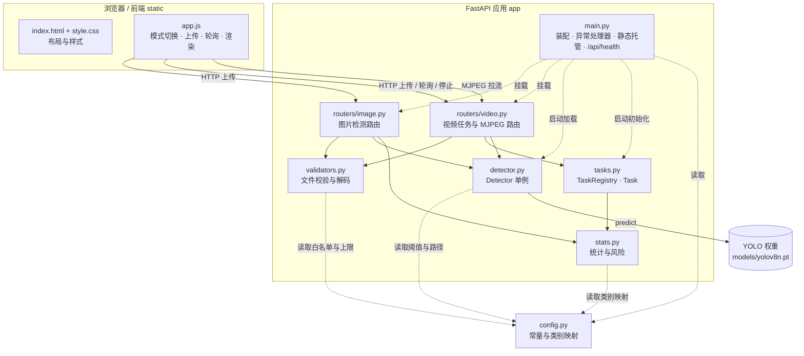
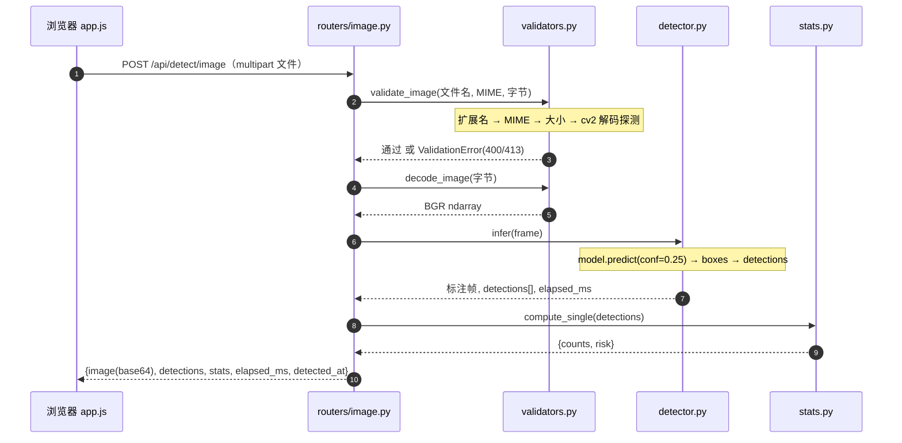
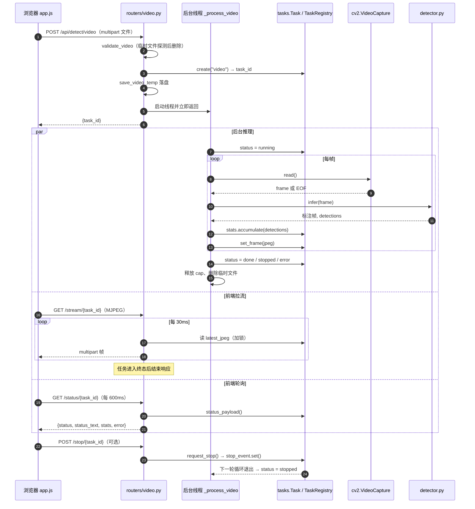
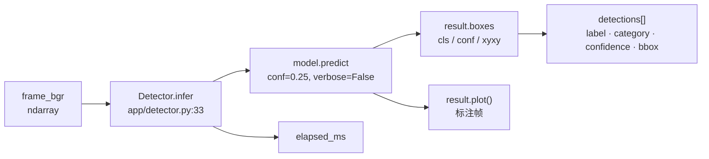
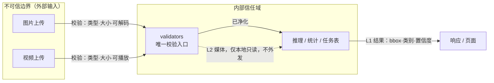

# 火点/烟雾目标检测 Web 应用 — 设计文档

- 日期：2026-10-12
- 状态：待用户审查
- 主题：基于 YOLO 的目标检测 Web 应用（图片 / 视频两种模式）

## 1. 背景与目标

赛题要求基于组委会提供的已训练 YOLO 模型，交付一个可在浏览器中使用、可在赛场指定环境构建启动的 Web 应用，形成「媒体输入 → 内容校验 → 模型推理 → 结果展示 → 统计告警」的业务闭环，支持图片检测与视频检测两种模式。

本设计**不涉及**模型训练、数据集构建、无人机/飞控/地图/应急系统接入。检测结果仅用于辅助识别，不替代人工复核与应急决策（页面上需有该免责声明）。

### 目标
- 调用真实 YOLO 权重完成图片与视频推理并输出结果。
- 展示标注后的画面、目标类别、置信度、位置、检测时间等信息。
- 对结果分类统计、给出风险提示与告警；页面统计与当前任务结果一致。
- 视频检测具备可理解的运行状态，支持停止、完成与模式切换；旧任务结果不得覆盖新任务。
- 对无效文件、媒体无法读取、模型加载失败给出可理解反馈并支持恢复。

### 非目标（YAGNI）
- 不做用户注册登录、多用户/多租户。
- 不做云端存储、数据库持久化（任务状态仅内存态，随进程结束销毁）。
- 不做模型训练、精度调优、数据标注。
- 不做真实视频流（RTSP）接入。
- 摄像头实时检测已作为后续能力实现，见 `2026-10-13-camera-detection-design.md`。

## 2. 能力要求映射

| 编号 | 能力要求 | 实现方式 |
|---|---|---|
| 1 | 媒体输入与检测 | 图片：单请求上传→校验→推理→返回；视频：上传→校验→创建任务→逐帧推理→流式输出 |
| 2 | 检测结果展示 | 后端渲染标注图/帧，返回检测明细数组（类别、置信度、bbox、检测时间） |
| 3 | 统计与告警 | 后端按任务维护统计（各类计数、峰值、风险等级），前端只展示后端返回的统计 |
| 4 | 视频任务管理 | 任务状态机 + task_id 隔离；支持停止、完成、模式切换；前端按 task_id 渲染 |
| 5 | 异常反馈与恢复 | 统一错误响应；校验失败/解码失败/模型加载失败分别给中文提示 + 恢复入口 |
| 6 | 工程交付 | 完整工程 + requirements.txt + README（指定 Python 解释器路径与启动命令） |

## 3. 技术选型

| 项 | 选择 | 理由 |
|---|---|---|
| 运行时 | conda 环境 `aigc`：`D:\miniconda\envs\aigc\python.exe` | 已含 Python 3.12.15、ultralytics 8.4.175、torch 2.14.1、opencv、fastapi、uvicorn，无需额外安装 |
| 后端 | FastAPI + Uvicorn | 轻量、异步、原生支持 StreamingResponse（MJPEG） |
| 前端 | 原生 HTML/CSS/JS（无构建） | 部署最简、赛场最稳 |
| 推理 | ultralytics `YOLO` | 官方接口，兼容 .pt 权重 |
| 视频流 | MJPEG（multipart/x-mixed-replace） | 实时、可中途停止，契合能力要求 4 |

## 4. 目录结构

```
luzhibei/
├─ app/
│  ├─ __init__.py
│  ├─ main.py           # FastAPI 入口、静态托管、路由挂载、启动时加载模型
│  ├─ config.py         # 常量：大小上限、类别名、阈值、目录路径
│  ├─ detector.py       # YOLO 单例加载 + 推理封装（annotate + 明细提取）
│  ├─ validators.py     # 文件校验：扩展名 / MIME / 大小 / 可解码性
│  ├─ tasks.py          # 任务状态机 + 内存任务表 + 停止信号
│  ├─ stats.py          # 分类统计 + 风险规则
│  └─ routers/
│     ├─ __init__.py
│     ├─ image.py       # POST /api/detect/image
│     ├─ video.py       # POST /api/detect/video, GET /stream/{id}, POST /stop/{id}, GET /status/{id}
│     └─ camera.py      # POST /api/detect/camera/start, GET /status/{id}, POST /stop/{id}, GET /stream/{id}
├─ static/
│  ├─ index.html
│  ├─ app.js
│  └─ style.css
├─ models/
│  └─ yolov8n.pt        # 占位模型（真实权重就位后替换为 权重.pt，接口不变）
├─ tests/
│  ├─ test_validators.py
│  ├─ test_stats.py
│  └─ test_tasks.py
├─ requirements.txt
└─ README.md
```

## 5. 系统架构与数据流

### 5.1 架构图



组件职责见第 4 节目录结构；接口清单如下：

| 方法 | 路径 | 说明 |
|---|---|---|
| POST | `/api/detect/image` | 图片检测，返回标注图与单帧统计 |
| POST | `/api/detect/video` | 创建视频任务，返回 `task_id` |
| GET | `/api/detect/video/status/{task_id}` | 轮询任务状态与累计统计 |
| POST | `/api/detect/video/stop/{task_id}` | 请求停止任务 |
| GET | `/api/detect/video/stream/{task_id}` | MJPEG 视频流 |
| GET | `/api/health` | 模型就绪状态与类别名 |

### 5.2 图片检测数据流



文字流：

```
上传图片 → validators 校验（扩展名/MIME/大小/可解码）
        → detector.infer → 标注图（JPEG base64）+ detections[]
        → stats.compute_single → 风险等级
        → 返回 {image, detections, stats, elapsed_ms, detected_at}
```

### 5.3 视频检测数据流



文字流：

```
上传视频 → validators 校验 → tasks.create(task_id, pending→running)
        → 独立线程：逐帧读取 → detector.infer → 标注帧 JPEG
                  → 写入该任务的 latest_jpeg（供 MJPEG 消费）
                  → stats.accumulate(逐帧)
                  → 检测到停止信号 / 读到 EOF / 出错 → 置 stopped|done|error
前端 GET /api/detect/video/stream/{task_id} → StreamingResponse(MJPEG)
前端 GET /api/detect/video/status/{task_id} → 轮询状态与统计
前端 POST /api/detect/video/stop/{task_id}  → 触发停止
```

### 5.4 模型调用链



- 加载：`Detector.load()`（`app/detector.py:18`）→ `YOLO(path)`，读取 `model.names` 存入 `class_names`；失败时 `ready=False`，`load_error` 为固定中文提示（不泄露服务器路径）。
- 类别归一：`stats.category_of()`（`app/stats.py:4`）把 `model.names` 的标签映射为 `fire / smoke / other`，映射表在 `app/config.py` 的 `FIRE_LABELS`、`SMOKE_LABELS`。

## 6. 任务状态机

```
pending → running → done        （正常处理到文件结束）
                 → stopped      （用户主动停止）
                 → error        （解码/推理异常）
```
- 每个任务独立 `task_id`（uuid4）。
- 任务表为进程内 `dict[task_id] -> TaskState`，附 `threading.Event` 作停止信号。
- 前端始终以「当前 task_id」为准渲染画面与统计；切换/新建任务时丢弃旧 task 的渲染结果，从机制上杜绝旧任务覆盖新任务。
- 停止语义：置停止事件 → 线程在下一次循环退出 → 状态置 `stopped`，已产生的统计保留。

## 7. 统计与告警规则

- 统计**由后端按当前任务权威计算**，随响应返回；前端不做独立计数，保证一致性。
- 图片任务：单帧内各类目标计数。
- 视频任务：累计各类目标框数量 + 每类峰值（单帧最大数量）+ 总处理帧数。
- 风险等级映射（阈值可配置，默认置信度阈值 0.25）：

| 触发条件 | 等级 | 展示 |
|---|---|---|
| 存在 fire 类目标 | high | 红色告警「检测到火点，请人工复核」 |
| 存在 smoke 类目标（无 fire） | medium | 橙色预警「检测到烟雾」 |
| 无目标 | normal | 绿色正常 |

- 页面显著位置展示免责声明：结果仅辅助识别，不替代人工复核与应急决策。

## 8. 错误处理

统一响应格式：`{ "code": <int>, "message": <中文可理解描述> }`，不含堆栈/内部路径。

| 场景 | HTTP | 提示 | 恢复方式 |
|---|---|---|---|
| 未选择文件 | 400 | 请选择要检测的文件 | 重新选择 |
| 扩展名/MIME 不合法 | 400 | 不支持的文件类型，仅支持 jpg/png/jpeg 或 mp4/avi/mov | 重新选择 |
| 超过大小上限 | 413 | 文件过大（图片≤10MB，视频≤200MB） | 重新选择 |
| 媒体无法解码 | 400 | 文件已损坏或无法读取，请更换文件 | 重新上传 |
| 模型加载失败 | 503 | 检测模型加载失败，请检查模型文件 | 页面提示 + 可重试接口 |
| 视频处理中异常 | 200(status=error) | 视频处理中断：<原因> | 重新上传 |
| 任务不存在 | 404 | 任务不存在或已结束 | 返回首页 |

- 模型加载在应用启动时执行；失败时不崩溃，记录状态，相关接口返回 503 与可理解提示（满足能力要求 5）。

## 9. 安全设计（SEC-DESIGN 自检）

### 9.1 信任边界与敏感标注图



### 9.2 设计要点

- **信任边界（DESIGN-1）**：所有上传文件（图片/视频）来自外部，属**不可信边界**，入口在 `validators` 统一校验；任务流/推理/统计为内部信任域。
- **数据流敏感标注（DESIGN-2）**：上传媒体为 L2（内部，不对外转发）；检测结果（bbox/类别/置信度）为 L1（可展示）；无 L3/L4 数据（无凭据、无个人信息）。不上传第三方。
- **外部依赖风险（DESIGN-3）**：ultralytics / torch / opencv / fastapi —— 均本地已安装、维护活跃；无对外网络调用，无供应链数据外泄风险。
- **认证授权（DESIGN-4）**：本应用为**本地单机工具**，赛题无多用户要求，**显式豁免鉴权**（SEC-01 显式声明）。若赛场要求鉴权需另行提出。
- **错误处理与日志（DESIGN-5）**：统一错误响应不含堆栈/内部类名；日志不含用户文件绝对路径明文（仅记录文件名与 task_id）；异常仅本地记录，不外报。
- **威胁建模摘要（DESIGN-6 / STRIDE）**：
  - Spoofing：单机无身份，豁免。
  - Tampering：上传文件仅用于只读推理，不执行。
  - Repudiation：本地日志记录任务 id 与状态迁移。
  - Information Disclosure：响应最小字段（SEC-04），不含服务器路径/堆栈。
  - DoS：文件大小上限 + 单任务单线程 + 速率合理约束（SEC-13）。
  - Elevation of Privilege：无权限体系，无多用户，豁免。
- **输入校验（SEC-03/13）**：扩展名 + MIME 白名单 + 大小上限 + cv2 实际解码校验（声明式，不事后处理）。

## 10. 测试策略

- **单元测试（pytest）**：
  - `validators`：合法/非法扩展名、超限大小、不可解码文件。
  - `stats`：单帧与累计统计、风险等级映射（含边界：空结果、仅烟雾、含火点）。
  - `tasks`：状态迁移、停止事件、task_id 隔离。
- **端到端手工验证**：准备样例图片与短视频，验证图片标注、视频流实时展示、停止/完成、模式切换、统计一致、异常提示。
- **测试重点（意图而非仅行为）**：测试需编码「为什么」——如「旧任务结果不得覆盖新任务」「统计必须与后端任务结果一致」，而非仅断言函数返回。

## 11. 部署与交付

- 运行时：`D:\miniconda\envs\aigc\python.exe`（含全部依赖）。
- 启动：`python -m uvicorn app.main:app --host 0.0.0.0 --port 8000`，浏览器访问 `http://localhost:8000`。
- 交付物：完整工程 + `requirements.txt`（记录版本）+ `README.md`（环境、构建、启动、访问说明）。
- 模型替换：真实权重到位后放入 `models/`，改 `config.py` 路径即可，推理接口不变。

## 12. 待办 / 已知问题

- **权重文件 `权重.pt` 当前为 0 字节（空文件）**，先用占位模型 `yolov8n.pt` 跑通全链路；真实权重到位后替换并重新验证类别名（fire/smoke）与配色。
- 项目目录当前非独立 git 仓库（父级 home 目录是仓库），git 策略待用户确认。
