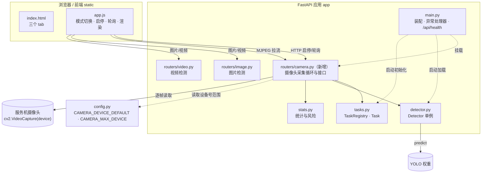
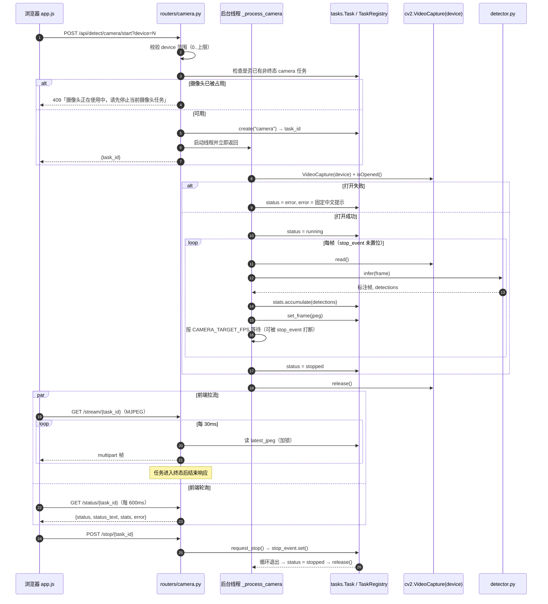
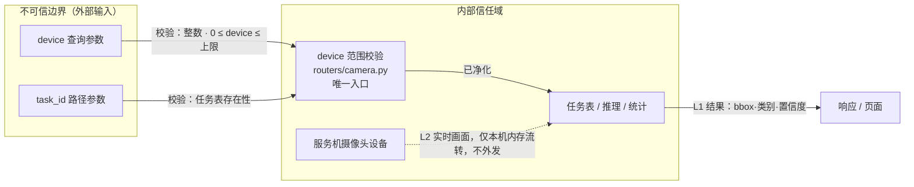

# 摄像头实时检测 — 设计文档

- 日期：2026-10-13
- 状态：待用户审查
- 主题：在现有火点/烟雾检测 Web 应用中新增「服务端摄像头实时检测」
- 关联：`docs/superpowers/specs/2026-10-12-fire-smoke-detection-webapp-design.md`

## 1. 背景与目标

现有应用支持图片与视频两种检测模式（文件输入）。本次新增第三种模式：**服务端摄像头实时检测**——由部署机上的摄像头采集画面，后端逐帧推理，前端实时预览并累计统计。

### 目标

- 前端新增「摄像头检测」tab，可输入设备号并一键开启/关闭。
- 后端打开服务机摄像头逐帧推理，输出标注帧与累计统计（火点/烟雾计数、峰值、风险等级）。
- 实时预览使用 MJPEG 流，可随时停止并释放摄像头。
- 摄像头不可用（不存在 / 被占用）时给出可理解的中文提示，应用不崩溃。

### 非目标（YAGNI）

- 不做 RTSP / 网络摄像头 / 无人机视频流接入。
- 不做浏览器端 `getUserMedia` 采集。
- 不做分辨率、帧率、镜像等参数配置。
- 不做多摄像头并行（同一时间仅一个摄像头任务）。

### 对既有设计的影响

原设计文档第 1 节「非目标」含一条「不做真实视频流（RTSP/摄像头）接入」。本次将「摄像头」部分移出非目标（RTSP 仍不做），需同步修订该条。

## 2. 方案选择

采用**方案 B：独立摄像头路由模块**。为降低对已验证视频链路的回归风险，不改造 `app/routers/video.py`，新建 `app/routers/camera.py` 承载摄像头采集循环与专属接口；**共享**领域组件（`tasks`、`stats`、`detector`、`validators`）不变。

代价：摄像头帧循环与视频帧循环存在结构相似的代码（约 40 行），后续修改这两处需保持一致。

## 3. 接口设计

| 方法 | 路径 | 参数 | 返回 | 说明 |
|---|---|---|---|---|
| POST | `/api/detect/camera/start` | `device`（query，默认 0） | `{task_id}` | 打开摄像头并创建实时任务 |
| GET | `/api/detect/camera/status/{task_id}` | — | 任务状态载荷 | 轮询状态与累计统计 |
| POST | `/api/detect/camera/stop/{task_id}` | — | `{task_id, status}` | 停止任务并释放摄像头 |
| GET | `/api/detect/camera/stream/{task_id}` | — | MJPEG 流 | 实时预览标注帧 |

> `device` 以**字符串**接收并在路由内解析为一个整数（而非依赖 FastAPI 的类型注解），以保证非法输入返回统一格式的 400 而不是框架默认的 422。

状态语义沿用 `app/tasks.py`：`pending → running → stopped | error`。摄像头流无自然结束，故不产生 `done`。

## 4. 系统架构与数据流

### 4.1 架构图

### 4.2 摄像头检测数据流

## 5. 任务与并发

- 摄像头任务复用 `app/tasks.py` 的 `Task`（含 `stop_event`、`stats`、`latest_jpeg`、`frame_lock`）与 `TaskRegistry`，`kind="camera"`。
- **独占约束**：`start` 前遍历任务表，若存在 `kind=="camera"` 且状态非终态的任务，返回 409，不新建任务。
- **释放保证**：`_process_camera` 在 `finally` 中执行 `cap.release()`，确保停止、异常、前端断流各路径都能释放设备。
- 前端在切换到其它 tab 或关闭页面时调用 `stop`，避免摄像头长期占用。

## 6. 错误处理

沿用统一响应格式 `{ "code": <int>, "message": <中文描述> }`（见 `app/main.py` 的异常处理器）。

| 场景 | HTTP | 提示 | 恢复方式 |
|---|---|---|---|
| device 非整数或超范围 | 400 | 摄像头设备号不合法，取值范围 0~N | 修改设备号重试 |
| 摄像头已被占用 | 409 | 摄像头正在使用中，请先停止当前摄像头任务 | 先停止再重试 |
| 摄像头无法打开 | 任务置 error（start 仍返回 200 + task_id） | 无法打开摄像头，请确认设备存在且未被占用 | 更换设备号或释放设备后重试 |
| 任务不存在 | 404 | 任务不存在或已结束 | 返回首页 |

> 说明：摄像头打开失败在后台线程内发生，`start` 已返回 `task_id`，前端通过轮询拿到 `error` 并展示；提示文案不含服务器路径（SEC-04）。

## 7. 安全设计（SEC-DESIGN 自检）

### 7.1 信任边界与敏感标注图

### 7.2 设计要点

- **信任边界（DESIGN-1）**：`device` 与 `task_id` 均来自外部，属不可信边界，入口在 `routers/camera.py` 统一校验；任务表/推理/统计为内部信任域。
- **数据流敏感标注（DESIGN-2）**：实时画面为 L2（仅本地内存流转，不上传、不外发）；检测结果（bbox/类别/置信度）为 L1。
- **外部依赖风险（DESIGN-3）**：`cv2.VideoCapture` 与 Ultralytics 均为本地库，无网络依赖；摄像头设备为本地硬件，无数据外泄风险。
- **认证授权（DESIGN-4）**：沿用本地单机工具的**显式鉴权豁免**（与原设计一致）；若部署为多用户环境需另行设计。
- **错误处理与日志（DESIGN-5）**：统一错误格式，不返回堆栈、内部类名与绝对路径。
- **威胁建模摘要（DESIGN-6）**：
  - Information Disclosure：响应最小字段；打开失败提示为固定文案。
  - DoS：`device` 范围校验 + 单摄像头任务独占（SEC-03/13）。
  - Tampering：摄像头画面仅用于只读推理，不持久化。
- **输入校验（SEC-03/13）**：`device` 必须为整数且落在 `[0, CAMERA_MAX_DEVICE]`，声明式校验，非法即 400。

## 8. 前端改动

- `static/index.html`：新增第三个 tab「摄像头检测」，面板含设备号输入（`type="number"`，默认 0）、开启/关闭按钮、状态徽标。
- `static/app.js`：
  - `switchMode` 扩展至三模式，切换到非摄像头模式时自动停止摄像头任务并清空预览。
  - 复用现有 `renderRisk` / `renderDetections` / 轮询渲染逻辑；`currentTaskId` 隔离机制不变。
- `static/style.css`：无新增样式规则（复用 tab/panel/viewer 现有类）。

## 9. 配置变更

在 `app/config.py` 新增：

- `CAMERA_DEVICE_DEFAULT = 0`
- `CAMERA_MAX_DEVICE = 9`
- `CAMERA_TARGET_FPS = 15`（采集循环的目标帧率上限，用于节流；实际帧率受推理耗时限制）

## 10. 测试策略

- **单元测试（新增 `tests/test_camera.py`）**：
  - `device` 参数解析与范围校验：合法 0/上限值通过；负数、超上限、非整数、缺失时使用默认值。
  - 摄像头独占：已存在非终态 camera 任务时 `start` 返回 409。
  - 摄像头打开失败：使用伪造的 capture（monkeypatch）验证任务被置 `error` 且提示为固定中文文案。
- **端到端手工验证**（需部署机有摄像头）：开启 → 实时预览刷新 → 状态显示「检测中」→ 统计刷新 → 停止 → 状态「已停止」 → 切换到图片/视频 tab → 摄像头任务自动停止。
- **测试意图**：测试需编码「为什么」——如「摄像头必须独占，避免多任务争抢设备」「停止后必须释放设备，避免设备被长期占用」，而非仅断言返回值。

## 11. 已知限制

- 依赖部署机存在可用摄像头；若服务部署在无摄像头的远程主机上该功能不可用（这是选择「服务端摄像头」方案的固有前提）。
- 摄像头帧循环与视频帧循环存在相似代码，后续修改需同步两处。
- 当前无鉴权与限流；若用于多人访问场景需另行设计。
