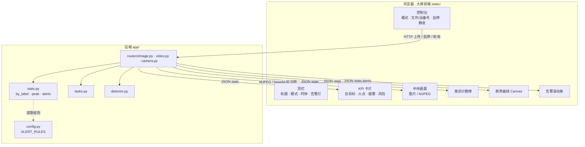
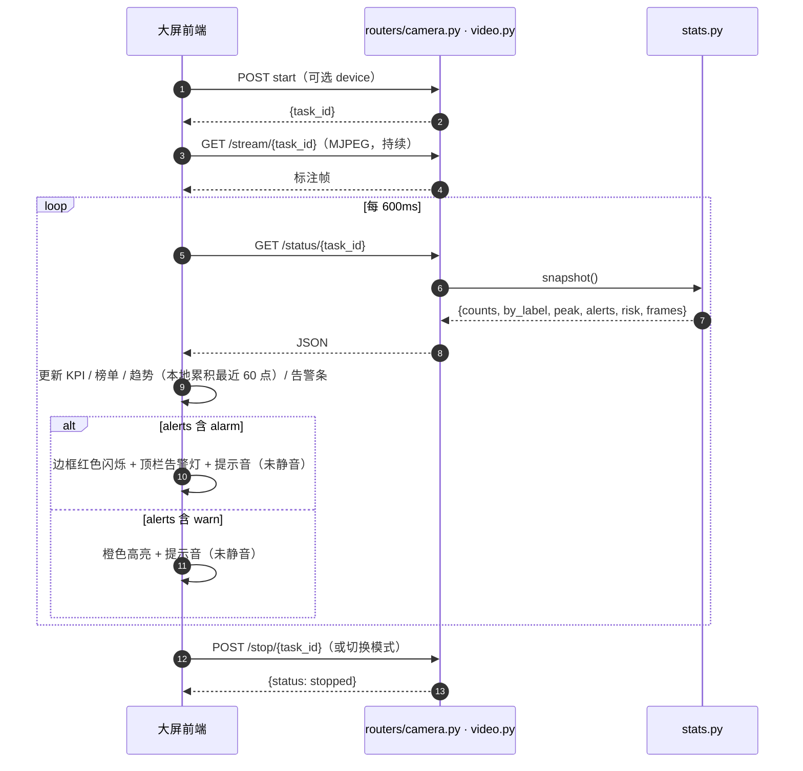
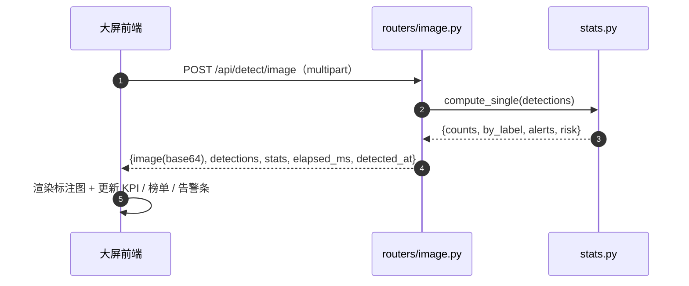
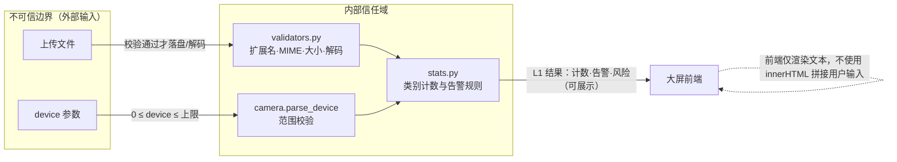

# 监控大屏前端重设计 + 类别计数与告警 — 设计文档

- 日期：2026-10-13
- 状态：已获用户批准
- 主题：将前端重构为深色科技蓝监控大屏，并增加按类别计数与预警/报警
- 关联：`2026-10-12-fire-smoke-detection-webapp-design.md`、`2026-10-13-camera-detection-design.md`

## 1. 背景与目标

现有前端为浅色卡片布局，信息密度低、无按类别统计、无告警表现。本次重做为**深色科技蓝监控大屏**，并补充两项能力：

1. **按类别计数**：不仅统计 fire/smoke/other，还输出模型实际检测到的每个类别数量（如 person×3、car×1）。
2. **预警/报警**：按类别规则命中时给出视觉 + 声音告警。

### 目标

- 大屏信息架构：顶栏（标题/模式/时钟/告警灯）+ KPI 卡片 + 中央实时画面 + 类别计数榜 + 实时趋势曲线 + 告警滚动条 + 控制台。
- 后端输出结构化统计：`by_label`（类别计数）、`peak`（峰值）、`alerts`（命中告警）、`risk`（总体风险）。
- 告警规则集中在 `app/config.py`，新增类别只需改规则表。
- 保留三种输入源（图片/视频/摄像头）与既有交互（占位引导、轮询、MJPEG、切模式停止）。

### 非目标（YAGNI）

- 不引入前端框架、构建工具与第三方图表/音频库（沿用原生 HTML/CSS/JS）。
- 不做告警的前端配置界面（规则在配置文件中维护）。
- 不做后端历史数据持久化（趋势曲线在前端本地累积）。
- 不做多用户/权限（沿用本地单机工具定位）。

## 2. 后端数据模型变更

### 2.1 统计结构

`app/stats.py` 的 `counts_from_detections()` 增加按真实类别聚合，`compute_single()` 与 `TaskStats.snapshot()` 的返回结构扩展为：

```json
{
  "counts": {"fire": 1, "smoke": 1, "other": 3, "total": 5},
  "by_label": {"fire": 1, "smoke": 1, "person": 2, "car": 1},
  "peak": {"fire": 1, "smoke": 1, "total": 5},
  "alerts": [{"label": "fire", "level": "alarm"}, {"label": "smoke", "level": "warn"}],
  "risk": "high",
  "frames": 120
}
```

- `counts` 与 `risk` 语义**保持不变**（向后兼容既有测试与逻辑）。
- `by_label` 为累计各类别数量（图片为单帧）。
- `peak` 在保留 `fire/smoke/other/total` 的同时，**同样按类别记录单帧最大值**（如 `peak["person"]` 表示单帧出现过的最多人数）与 `peak["total"]`。
- `alerts` 列出当前命中告警规则的类别与级别。

### 2.2 告警规则

`app/config.py` 新增：

```python
ALERT_ALARM = "alarm"
ALERT_WARN = "warn"
ALERT_RULES = {
    "fire": ALERT_ALARM, "flame": ALERT_ALARM, "火点": ALERT_ALARM, "火焰": ALERT_ALARM,
    "smoke": ALERT_WARN, "烟雾": ALERT_WARN,
}
```

`stats.alert_level(by_label)` 返回 `alarm | warn | normal`，并驱动 `risk`：

| 命中情况 | alerts 级别 | risk |
|---|---|---|
| 任一类别为 `alarm` | alarm | high |
| 仅 `warn` | warn | medium |
| 无命中 | — | normal |

这样 `risk` 由规则统一推导，避免两套判定逻辑。

## 3. 系统架构与数据流

### 3.1 大屏架构图



### 3.2 实时流数据流（视频 / 摄像头）



### 3.3 图片检测数据流



## 4. 大屏布局与视觉规范

### 4.1 布局

```
┌──────────────────────────────────────────────────────┐
│ 顶栏：系统标题 │ 当前模式 │ 实时时钟 │ ● 告警状态      │
├────────────┬────────────────────────┬────────────────┤
│ KPI 卡片    │   中央实时画面          │ 类别计数榜      │
│ 总目标数    │   （图片 / MJPEG 流）   │ 条形排行 + 计数 │
│ 火点 / 烟雾 │                        ├────────────────┤
│ 风险等级    │                        │ 实时趋势曲线    │
├────────────┴────────────────────────┴────────────────┤
│ 控制台：图片│视频│摄像头 + 文件/设备号 + 开始/停止/静音 │
├──────────────────────────────────────────────────────┤
│ 告警滚动条：命中类别 · 级别 · 时间（最近 50 条）        │
└──────────────────────────────────────────────────────┘
```

### 4.2 视觉规范

| 用途 | 取值 |
|---|---|
| 页面背景 | `linear-gradient(180deg, #070d1a, #0b1730)` + 网格纹理 |
| 面板 | `rgba(15,30,56,.72)`、1px `#1e3a5f` 边框、四角装饰线 |
| 主色（青蓝） | `#22d3ee` / `#38bdf8`，发光 `0 0 12px rgba(34,211,238,.45)` |
| 正常 / 预警 / 报警 | `#22c55e` / `#f59e0b` / `#ef4444` |
| 文字 | 主 `#dbeafe`、次 `#93c5fd`、弱 `#64748b` |
| 数字 | 等宽（`tabular-nums`），KPI 大字号 |

### 4.3 交互

- **趋势曲线**：Canvas 手绘折线 + 渐变填充，前端本地累积最近 60 次采样，不新增后端接口。
- **音效**：Web Audio 振荡器生成提示音（报警 880Hz 双响、预警 660Hz 单响），无音频文件；顶栏静音开关，**默认静音**（浏览器自动播放策略要求先有用户交互）。
- **告警表现**：报警时面板边框红色闪烁（CSS 动画）+ 顶栏告警灯；告警条追加记录（保留最近 50 条，含类别、级别、时间）。
- **保留**：占位引导提示、切模式自动停止、任务隔离（`currentTaskId`）。

## 5. 安全设计（SEC-DESIGN 自检）

### 5.1 信任边界与敏感标注图



### 5.2 设计要点

- **信任边界（DESIGN-1）**：上传文件与 `device` 为不可信边界，入口校验沿用 `validators` 与 `camera.parse_device`，本次不新增外部输入面。
- **数据流敏感标注（DESIGN-2）**：统计与告警结果为 L1（可展示）；上传媒体为 L2（仅本地）。
- **外部依赖风险（DESIGN-3）**：新增零外部依赖（Canvas 与 Web Audio 均为浏览器原生能力）。
- **认证授权（DESIGN-4）**：沿用本地单机工具的显式鉴权豁免。
- **错误处理与日志（DESIGN-5）**：沿用统一错误格式；前端错误提示只用文本节点，不使用 `innerHTML` 拼接（SEC-07）。
- **威胁建模摘要（DESIGN-6）**：类别计数与告警均为只读展示；无提权与篡改面；告警音效为本地生成，无外部资源加载。

## 6. 测试策略

- **单元测试（pytest，扩展 `tests/test_stats.py`）**：
  - `by_label` 按真实类别聚合正确（含多类别同帧）。
  - `alerts` 命中规则：fire → `alarm` + `risk=high`；仅 smoke → `warn` + `risk=medium`；未命中 → `normal`。
  - `peak` 按类别与 total 记录单帧最大值。
  - 既有 5 个用例必须保持通过（`counts` 与 `risk` 语义不变）。
- **前端验证**：启动服务后检查静态资源加载与关键元素存在；`node --check` 校验语法。
- **手工验证**：图片/视频/摄像头三条链路的 KPI、榜单、趋势曲线、告警条更新；静音开关与提示音；切模式自动停止。

## 7. 已知限制

- 类别计数依赖模型 `names`；占位模型为 COCO 80 类，**真实火点权重到位后需核对告警规则表中的 label 是否与权重类别名一致**。
- 趋势曲线为前端本地采样，刷新页面后重置。
- 前端三个文件整体重写，`app.js` 规模增大（仍保持单文件，不引入构建工具）。
